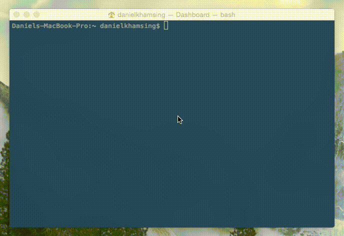

SL(1): Cure your bad habit of mistyping
=======================================

SL (Steam Locomotive) runs across your terminal when you type "sl" as
you meant to type "ls". It's just a joke command, and not useful at
all.

Copyright 1993,1998,2014 Toyoda Masashi (mtoyoda@acm.org)



## HOW TO INSTALL DEPENDENT LIBRARY
```bash
sudo apt-get install libncurses5-dev libncursesw5-dev
```

## HOW TO INSTAll
```bash
bash build.sh
```
